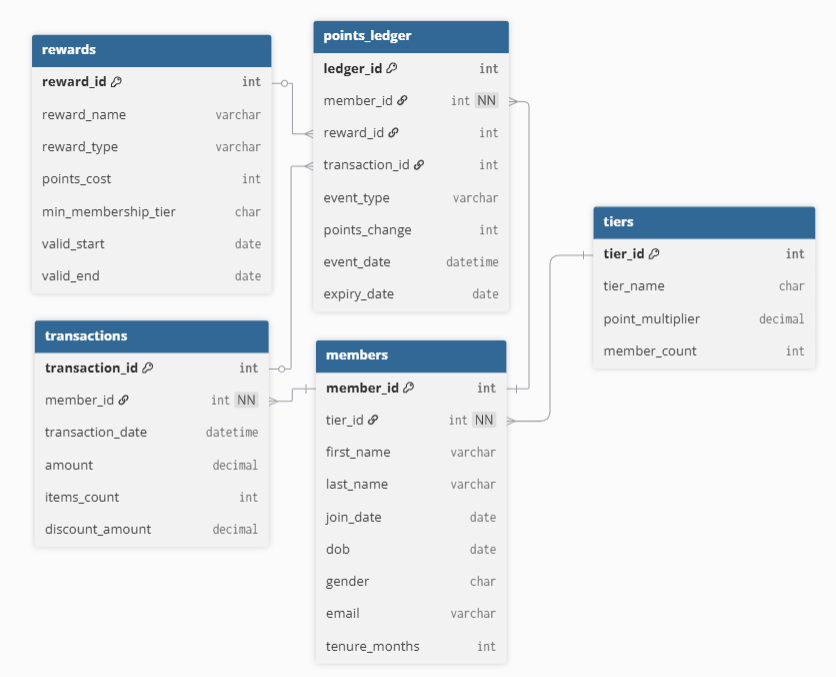

# loyalty-program-analytics-synthetic-data

## About
This project presents a synthetic data generation system that simulates a loyalty program for a coffee shop. The system models key components such as members, transactions, points accumulation, reward redemption, and tier progression. 

See full documentation [here](/data_documentation.pdf)

## Use Case
The primary use case is to analyze how customers earn, redeem, and lose points over time, and how these activities influence purchasing patterns and tier progression. The dataset allows analysts to explore key business questions such as:
- How frequently do customers make purchases and earn points?
- What proportion of points are redeemed versus expired (breakage)?
- How do customers transition between loyalty tiers?
- Which customer segments contribute the most revenue and engagement?

## Dataset Overview

### Schema

### Entity Tables
#### Members
The members table stores demographic and profile information of each customer in the loyalty program. It serves as the central entity that links to transactions and points activity.

| Field | Type | Description |
| --- | --- | ---|
| member_id (PK) | INT | Unique identifier per member |
| first_name | VARCHAR | Member's first name |
| last_name | VARCHAR | Member's last name |
| date_of_birth | DATE | Member's birth date |
| join_date | DATE | Date the member joined the program |
| age | INT | Member's age |
| email | VARCHAR | Member's email address |
| gender | CHAR | Member's gender |
| current_tier (FK) | INT | References current loyalty tier of member |
| tenure_months | INT | Length (in months) of member's tenure in the program |

#### Transactions
The transactions table contains all purchasing activities and records  details such as transaction date, amount spent, number of items, discount amount.

| Field | Type | Description |
| --- | --- | ---|
| transaction_id (PK) | INT | Unique identifier per transaction |
| member_id (FK) | INT | References member who made the transaction |
| transaction_date | DATETIME | Date the transaction transpired |
| amount | DEC | Total amount spent in the transaction |
| items_count | INT | No. of items in the transaction |
| discount_amount | DEC | Amount discounted from the transaction |

#### Tiers
The tiers table contains information about the different tiers (Bronze, Silver, Gold) of the loyalty program including the member count and point multiplier to be used for calculating the earned points.

| Field | Type | Description |
| --- | --- | ---|
| tier_id (PK) | INT | Unique identifier per tier |
| tier_name | CHAR | Name of tier |
| member_count | INT | No. of members per tier |
| points_multiplier | DEC | Points multiplier per tier |

#### Rewards
The rewards table stores the catalog of all rewards in the loyalty program along with their availability periods and point cost.

| Field | Type | Description |
| --- | --- | ---|
| reward_id (PK) | INT| Unique identifier per reward |
| reward_name | VARCHAR | Name of reward |
| reward_type | CHAR | Type of reward (e.g. Food, merch)
| min_membership_tier | CHAR | Minimum tier required for viability |
| valid_start | DATE | Starting date of validity |
| valid_end | DATE | Ending date of validity |
| points_cost | INT | Cost of redemption |

#### Points Ledger

The points ledger table records all point-related events for each member. This includes earning events from transactions, burning through reward redemptions, and expiry, providing a complete log of all changes in a member’s point balance

| Field | Type | Description |
| --- | --- | ---|
| ledger_id (PK) | INT | Unique identifier per ledger |
| member_id (FK) | INT | References member associated with the event |
| transaction_id (FK) | INT | References the related transaction (if applicable) |
| reward_id (FK) | INT | References the reward redeemed (if applicable) |
| event_date | DATETIME | Timestamp of event |
| event_type | CHAR | Type of event (EARN, BURN, EXPIRY) |
| points_change | DEC | No. of points added or deducted
| expiry_date | DATE | Date of point expiry |

## Contributors
- Darlyn Baybayon
- Angela Taningco
